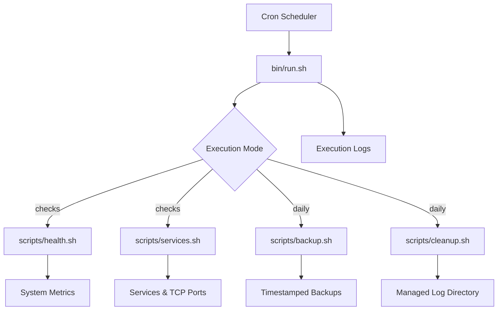

# System Architecture

## Overview

Linux Server Health & Backup Toolkit is a modular Bash-based automation system.

It separates system monitoring, backup management, log cleanup, and execution orchestration into independent scripts.

## Architecture Diagram

## Components

### Central Runner — bin/run.sh

- Accepts `checks` or `daily` mode.
- Executes the relevant scripts.
- Captures execution output.
- Tracks failed modules.
- Uses file locking to reduce overlapping executions.

### Health Monitoring — scripts/health.sh

Collects CPU utilization, memory utilization, disk usage, and system uptime.

Classifies utilization using configurable thresholds defined within the script.

### Service Monitoring — scripts/services.sh

Checks whether a specified systemd service is active and whether a TCP connection can be established to the configured host and port.

### Backup Manager — scripts/backup.sh

Creates compressed timestamped archives from the configured source directory.

Uses a temporary archive, performs readability verification, and publishes the backup after successful verification.

### Log Cleanup — scripts/cleanup.sh

Identifies old regular `.log` files within the restricted managed directory.

Dry-run mode is enabled by default. Actual deletion requires the `--apply` argument.

## Execution Flow

1. Cron triggers `bin/run.sh checks` at its configured schedule.
2. The runner acquires a mode-specific file lock.
3. The runner executes health and service checks.
4. Each module returns its execution status.
5. The runner records results in timestamped log files.
6. A nonzero runner exit code indicates that at least one check failed or execution encountered an error.

The `daily` mode executes backup creation followed by cleanup in dry-run mode. It is currently intended for manual execution until storage capacity and scheduling policies are reviewed.

## Data Storage

Generated local files are stored under:

- `runtime/backups/`
- `runtime/logs/`
- `runtime/test-data/`

These runtime directories are excluded from Git version control.

## Safety and Limitations

- Cleanup is restricted to a managed directory.
- Cleanup performs no deletion by default.
- Log and lock file checks offer basic protection, not complete race-condition security.
- Backups remain local and are not a substitute for off-site disaster recovery.
- Scheduled execution requires an active Linux environment.
- The toolkit is intended for learning and controlled operational use, not unattended production deployment without further hardening.
